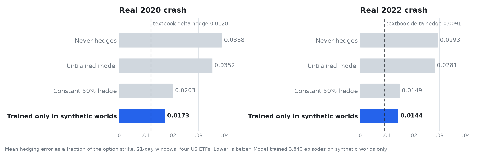

  <picture>
    <source media="(prefers-color-scheme: dark)" srcset="assets/logo-dark.svg">
    
  </picture>

<h1 align="center">Trained only in synthetic markets. Better on the real 2020 and 2022 crashes.</h1>

  An RL agent that never saw a real price learned to hedge options in generated market worlds, 
  then cut its error on the real crashes it had never seen. Pre-registered, with every trace to reproduce it.

  
  
  
  

  <picture>
    <source media="(prefers-color-scheme: dark)" srcset="assets/hero-dark.png">
    
  </picture>

We trained a small language model, by reinforcement learning, to hedge an option position. It practiced
exclusively in synthetic market worlds: generated price paths, rebased to 100, no dates, no tickers, no news.
It never saw a real price. Then we scored it on the real 2020 and 2022 crashes.

| Real crisis | Untrained model | Trained in synthetic worlds | Difference (95% CI) | Worst-10% loss |
|---|---|---|---|---|
| 2020 | 0.0352 | 0.0173 | −0.0180 [−0.0264, −0.0093] | 0.123 → 0.064 |
| 2022 | 0.0281 | 0.0144 | −0.0137 [−0.0213, −0.0071] | 0.082 → 0.039 |

Losses are hedging error as a fraction of the option strike (lower is better). For scale, on the same windows a
player that never hedges scores 0.0388 / 0.0293, a constant 50% hedge 0.0203 / 0.0149, and the textbook delta
hedge 0.0120 / 0.0091. The untrained model behaves like the no-hedge player; the trained one lands between the
constant hedge and the textbook formula, and roughly halves the worst-10% loss.

The pass/fail rule for this test was written and committed before any exam score existed (`prereg/PREREG.md`).
Every number above is reproducible from the per-episode traces in this repo with one command (below).

## Why this is interesting for RL environments

Finance is a hard place to build training environments. Real history is short, and every large model has
read it, so "test on 2020" measures recall as much as skill. Synthetic worlds solve both problems only if two
things hold: the agent must actually learn in them, and what it learns must carry over to real markets.

- **It learns.** On 400 held-out synthetic worlds the model went from −0.0203 (untrained) to −0.0112 after
  3,840 practice episodes, with a paired-bootstrap CI excluding zero from the first checkpoint
  (`runs/stage0_pilot/SCORING.txt`).
- **It carries over.** The table above: the same adapter, scored on real crashes it had never seen.
- **It cannot be recall.** The worlds are new price paths. We attacked the scoring ourselves before using it: a
  lookup strategy that memorises the practice worlds reaches the oracle ceiling on them and collapses 53× on
  fresh worlds, while an honest strategy transfers with no gap (`memorization/`, computed on an earlier
  internal environment with the same game). The model trained here never saw the exam paths, and no amount
  of memorising the practice paths would help on real 2020.

## A second, larger run

To check the effect is not one lucky seed, we trained five independent adapters of a larger model
(Qwen3-4B-Instruct-2507, same budget, same synthetic worlds) and scored each on the same real windows
(`scripts/trained_vs_untrained.py`). The larger model is a better hedger before any training (mean loss 0.0263 /
0.0232 vs 0.0352 / 0.0281 for the small one), so there is less room to gain, and the gains are smaller:

| Real crisis | Untrained (4B) | Trained, 5 seeds pooled | Difference in mean loss (95% CI) | Worst-10% loss difference |
|---|---|---|---|---|
| 2020 | 0.0263 | 0.0219 | −0.0044 [−0.0070, −0.0024] | −0.0062 [−0.0176, +0.0129] (n.s.) |
| 2022 | 0.0232 | 0.0189 | −0.0043 [−0.0061, −0.0029] | −0.0052 [−0.0096, −0.0019] |

Per seed, the trained model is better on mean loss in 4 of 5 seeds on 2020 (one seed is flat) and 5 of 5 on
2022. The direction holds; the size of the transfer depends on how much the untrained model already knows.

## What we did, exactly

**The game.** You are short one at-the-money call expiring in 21 trading days and were paid a fair premium for
it. Each day you choose a hedge ratio in [0, 1], the share of the underlying to hold. Changing it costs 5 bps of
the traded value. Score = −(|option payoff − premium − hedging P&L| / strike + costs): zero is a perfect
replication. This is the standard deep-hedging objective; it rewards protection, not profit.

**What the agent sees.** A system prompt with the rules, then one message per day: the last ten prices, today's
price, the current hedge. Prices are rebased to 100 at day 0. No asset name, no date, no news. It replies with
a short rationale and `[HEDGE 0.xx]`. Everything is in `hedge_gym/` (a verifiers-v1 environment).

**Practice worlds.** 3,600 synthetic 21-day paths for each of four US ETFs (large caps, tech, small caps,
long bonds), generated by a model fitted on data up to 2019-12-31, conditioned on real market states from
2011–2019, and volatility-matched to the 2003–2019 history of each asset. 400 worlds were held out for the
learning check and never trained on; they are in `banks/era2019_flow_heldout.npz` (metadata inside the file).
The 14,000-path training bank is not in this repo; it is available on request (team@sablier.ai), and its
SHA-256 is recorded in `runs/stage0_pilot/MANIFEST.json`. The per-asset option premium shown to the agent is
the mean payoff over 2003–2019 real windows.

**Training.** Qwen3-1.7B, LoRA rank 32, group-relative policy optimisation (prime-rl), 60 steps × 64
episodes × group 16 = 3,840 practice episodes. One A100 pair, about 13 hours, about $150
(`configs/stage0_rl.used.toml`, `runs/stage0_pilot/`).

**The exam.** Every real 21-day window starting on a 5-day grid in calendar 2020 (47 per asset) and 2022
(46 per asset), the four assets, greedy decoding, the same prompt and accounting. The "untrained" control is
the base model served through the same adapter path with an all-zero adapter, because the serving path
itself shifts scores by about 0.001 (`runs/stage0_pilot/SCORING.txt`: the all-zero adapter scores −0.0215
against −0.0203 for the plain model on the same worlds).

**Statistics.** Paired by window; moving-block bootstrap over window-start dates (block 5, all four assets
carried together on each date, 10,000 resamples) so that overlapping windows do not inflate the confidence.
The pass bar, fixed in advance: trained better than untrained with the CI excluding zero on *both* crises.

## What this does not show

- **Which synthetic worlds.** This write-up makes no claim that our generator is better than other sources of
  practice data; that is a separate comparison and a separate write-up. The claim here is that practice in
  synthetic markets transfers to real crises at all.
- **A good hedger.** The trained model still loses to the textbook delta hedge on both crises. The result is
  about transfer, not about beating finance.
- **Generality.** One task (single-asset option hedging), four ETFs, 21-day horizons, two small models, about
  $1,000 of compute in total. Effect sizes shrink as the untrained model gets stronger.
- **Profit.** The score is replication error, not P&L. The practice worlds carry the ordinary upward drift of
  the 2011–2019 era they are conditioned on, and nothing here says anything about making money.

## Reproduce every number

    pip install -r requirements.txt
    python scripts/transfer_analyze.py runs/transfer --banks banks      # the headline table
    python scripts/score_pilot.py runs/stage0_pilot                     # the learning check (Stage 0)
    python scripts/trained_vs_untrained.py                              # the 5-seed 4B check
    python scripts/baselines.py exam_2020_overlap exam_2022_overlap     # the scripted reference players

Per-episode traces: `runs/**/traces/stream/*.jsonl[.zst]` (reward at
`traces[0].rewards.hedge_score.score`). Configs actually run: `configs/`. Environment: `hedge_gym/`.
None of the scripts needs the training bank. The training bank and the trained adapters are available on
request: team@sablier.ai.

## Who did this

The experiments were designed and run by Sablier (sablier.ai), who make the
synthetic market generator used for the practice worlds. The code and traces in this repo are released under
the MIT licence (`LICENSE`); the synthetic worlds in `banks/` are released for research and reproduction only
(`DATA_LICENSE.md`); the generator itself is not part of this release.
